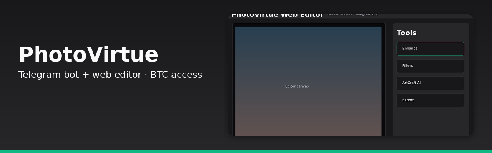
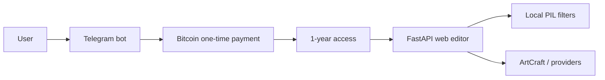

<p align="center">
  
</p>

# PhotoVirtue

**Telegram bot and browser photo editor with Bitcoin one-time payments for 1-year access.**

[](#license)


Original IP by Anthony Jones. Python stack: Telegram bot (`telegram_bot.py`), FastAPI web editor (`web_editor.py`), and a Tkinter desktop editor (`photo_virtue.py`).


## How it works



Python stack: `telegram_bot.py` for BTC-provisioned access, `web_editor.py` FastAPI editor with local PIL and optional ArtCraft providers.

## Features

- Telegram bot entry for paid access
- Browser photo editor (FastAPI + Pillow)
- Desktop Tkinter editor with layers/filters concepts
- Bitcoin one-time payment model described in project docs ($19/year access)

## Tech stack

- Python 3
- python-telegram-bot / FastAPI / uvicorn
- Pillow
- Tkinter (desktop editor)

## How to run

```bash
python -m venv .venv
source .venv/bin/activate
pip install -r requirements.txt
```

See `AGENTS.md` for development rules. Bot and editor entrypoints are `telegram_bot.py` and `web_editor.py`.

## Status

Public. Early codebase. Payment and deploy wiring are not finished in-repo.

## License

All rights reserved. Original IP by Anthony Jones.
